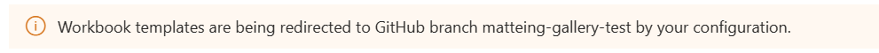
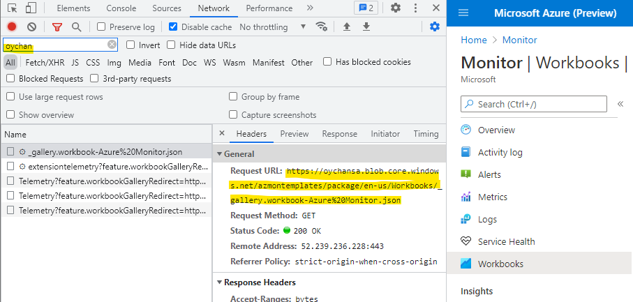

# How to test your changes

Testing changes to a template can be done in three ways:

1. [**Using Advanced Mode**](#using-advanced-mode): Works locally in your browser, exclusively for you.
2. [**Automated browser validation**](#automated-browser-validation-opt-in): Opt-in Playwright smoke tests and explicit UI contracts.
3. [**Redirecting to a GitHub Branch**](#redirecting-the-gallery-to-a-github-branch): Allows anyone with the URL to test changes temporarily; slightly more complicated but widely accessible.

## Using Advanced Mode

If you're only modifying a workbook, you can test your changes locally without any usage of Git. Follow these steps:

1. **Create an empty workbook.**
2. **Access Advanced Mode.**
3. **Paste the contents of the `.workbook` template file into Advanced Mode.**
4. **Click on the `Apply` button.**

> [!TIP]
> If your template content is valid, it will appear in the view. If not, you'll receive an error notification explaining why your content is invalid.

## Automated browser validation (opt-in)

The browser validator complements the existing JSON/gallery validators and the [static analyzer](../scripts). It follows the repository's Mocha conventions, but authenticated tests live under `test/browser/` and are **not included in normal `npm test` discovery or CI**. Fast regression tests for the validator itself run in normal CI. `playwright-core` does not download a browser.

For real-DOM safety/pixel regression tests without Azure sign-in, set `WORKBOOK_BROWSER_EXECUTABLE` to an installed Chromium/Edge executable and run `npm run test:browser:safety`. This opt-in suite uses synthetic `about:blank`/`srcdoc` fixtures, blocks external requests, tests overlapping and late parent overlays, and cleans its test-only screenshots. It does not use or alter your signed-in browser.

The shared runner:

- Supports either an explicitly selected/confirmed tenant or explicitly authorized browser-session continuation. The latter uses and privately pins the already-signed-in directory only if no chooser is pending. Both workflows recheck identity before tab changes, parameter actions, and screenshots and never choose or switch an account/tenant.
- Refuses to replace a saved workbook or a non-empty Advanced Editor, and targets only the model bound to the visible editor rather than cached background models.
- Applies the exact requested source and reports its normalized-source SHA-256, not its contents.
- Checks the primary parameter-driven tabset's labels and selected states using native Enter-key activation, which remains usable during query-driven layout reflow.
- Optionally checks that deferred content is not mounted before a source-defined toolbar parameter action, appears after it, and hides its producer when requested. The runtime toolbar's full static labels must match the source; a same-label Markdown/query hyperlink is never a fallback. A self-hiding producer must have its visibility parameter declared as global before it.
- Optionally verifies exact grid column labels and row bounds using `aria-rowcount`, not the number of virtualized rows currently rendered.
- Offers optional local screenshots, disabled by default, with conservative masking applied before capture and a mandatory manual-review reminder.

Commands and parameter actions use native Enter-key activation after visibility and enabled-state checks. This validates the accessible interaction path without depending on pointer coordinates during query-driven reflow; it does not certify mouse hit testing.

**This is smoke and contract validation, not automatic validation of every query or workflow.** Nested tabsets, filters, graphs, row selections, query correctness, and effective resource coverage still need scenario-specific tests. A requested grid contract fails when no result grid is available; no-data is not reported as healthy or as a passing data check.

### Open Portal and select the tenant in the external browser

When the user asks to select the tenant in the browser, open `https://portal.azure.com/` in an **external Playwright/CDP browser**, not the integrated VS Code browser. Do not block opening the sign-in page with repeated tenant forms. Generate a portal-only helper:

```powershell
New-Item -ItemType Directory -Force .playwright-mcp | Out-Null
npm run test:browser:script -- --open-portal --output ".playwright-mcp\open-portal.js"
```

Run this `async (page) => { ... }` function on a blank external browser page. It opens Portal and returns **`status: "paused"`** at sign-in or an account/tenant/directory chooser, without selecting or submitting anything. **Pause and let the user choose there, including in autopilot.** Rerun after they finish. A sign-in helper result always has `workbookValidated: false`; it is never evidence that a workbook passed.

If Portal is already authenticated without a pending chooser, the helper reports **`status: "ready"`**. When the user has authorized continuing with that session, use `--use-browser-tenant` for the validation script or `WORKBOOK_BROWSER_USE_BROWSER_TENANT=true` for Mocha. No additional tenant form is required. The runner privately pins the observed directory for that validation run and stops if it changes.

The helper does not navigate away from an existing portal workbook or restart an active sign-in challenge, and refuses to replace unrelated pages. Portal navigation does not approve data scopes: confirm the intended non-production subscriptions before queries, and obtain screenshot consent separately.

For **strict expected-tenant validation**, keep using `--tenant <guid> --confirm-tenant` or the explicit-tenant environment variables below. Browser-session mode cannot silently replace an explicit tenant constraint or combine with strict-tenant flags. If neither workflow is authorized, ask **which tenant to use** and pause on an unavailable/declined/cancelled response.

The repository [browser-validation skill](../.github/skills/validate-workbook-browser/SKILL.md) codifies both workflows. The user performs sign-in/directory switching themselves. Do not request credentials, commit tenant/account information, or reuse a prior run's confirmation. The runner collects every parenthesized GUID after `Directory:` in English portal account-menu metadata and rejects conflicting candidates, including a GUID embedded in a display name. Missing/ambiguous identity or a later chooser pauses validation. Tenant IDs and account metadata are not included in reports.

### Prepare a browser

Use Node 24, as in CI, and run `npm install`. Use only trusted templates and a non-production account with Reader permissions at the intended scopes. Rendering a real template can execute its queries and incur query costs. The runner does not click Save or ARM action links, capture authentication state, or collect traces. Screenshots require a separate explicit opt-in.

Finish any account/tenant selection in the **current English-language React workbook view**. In the browser that will run the test, create a **new empty unsaved workbook**, open **Advanced Editor**, and leave its default empty JSON in place. The validator supplies the template; do not paste it first. It deliberately does not automate sign-in or discard an existing draft.

### Run the Mocha validator against a local browser

Start a dedicated Chromium-based browser with a loopback debugging port and a separate profile **outside the repository**. Do not expose the port publicly or use your normal profile. For example, on Windows:

```powershell
& "C:\Program Files (x86)\Microsoft\Edge\Application\msedge.exe" --remote-debugging-address=127.0.0.1 --remote-debugging-port=9222 --user-data-dir="$env:LOCALAPPDATA\WorkbookBrowserValidation"
```

After preparing Azure and Advanced Editor in that browser:

```powershell
$env:WORKBOOK_BROWSER_TEMPLATE = "test\browser\fixtures\Smoke.workbook"
$env:WORKBOOK_BROWSER_CHECKS = "test\browser\fixtures\smoke-checks.json"
$env:WORKBOOK_BROWSER_CDP_ENDPOINT = "http://127.0.0.1:9222"
$env:WORKBOOK_BROWSER_TENANT_ID = "<user-selected-tenant-guid>"
$env:WORKBOOK_BROWSER_TENANT_CONFIRMED = "true"
npm run test:browser
```

Replace the placeholder only after the user has selected and confirmed it. The confirmation environment value must be exactly `true`; missing or false approval pauses before CDP connection. Clear private per-run variables afterward.

For the in-browser flow, **instead of** the two strict-tenant variables, set:

```powershell
$env:WORKBOOK_BROWSER_USE_BROWSER_TENANT = "true"
```

Clear strict-tenant variables before choosing this mode. If there is exactly one blank/portal/sign-in tab and no eligible workbook editor, the Mocha adapter opens/checks Portal there and pauses with setup instructions; it does not pretend a workbook was validated. Multiple candidate tabs are never selected arbitrarily. Once signed in, create the new empty workbook and rerun. The adapter does not launch a new browser process or use the integrated VS Code browser; it attaches to your dedicated external CDP browser.

The checks file is optional. The runner requires exactly one eligible portal page, reports configuration/authentication failures as failures, and disconnects its client afterward without creating or closing browser contexts. Close the dedicated browser yourself when finished. Only credential-free loopback HTTP CDP endpoints are accepted.

### Run with an existing Playwright or MCP browser

If a browser tool already supplies an authenticated Playwright `page`, generate a self-contained function for that tool instead of opening a debugging port:

```powershell
New-Item -ItemType Directory -Force .playwright-mcp | Out-Null
npm run test:browser:script -- --workbook "test\browser\fixtures\Smoke.workbook" --checks "test\browser\fixtures\smoke-checks.json" --tenant "<user-selected-tenant-guid>" --confirm-tenant --output ".playwright-mcp\workbook-check.js"
```

Prepare a new empty unsaved workbook's Advanced Editor in the tool's selected tab, then run the generated `async (page) => { ... }` function. Use the tool's `filename` input where available, pointing to the generated file's absolute path. The function uses no Node imports inside the browser tool. Hosts can impose shorter call timeouts; use the local Mocha runner for longer validations.

For the already-authenticated browser-session workflow, replace `--tenant ... --confirm-tenant` with **`--use-browser-tenant`**. This explicitly authorizes using the observed session; a later account/tenant chooser still pauses and no choice is made for you. `--no-use-browser-tenant` revokes a checks-file browser-session opt-in.

Generate into a directory your browser tool permits. Existing output files are never overwritten: choose a fresh name or remove only your previous generated file before regenerating. Generated scripts contain the template and its checks, **not authentication state**; keep them private and remove them after use. `.playwright-mcp/` is ignored by Git.

A script can be generated offline without tenant confirmation, but its live execution will pause before accessing a browser. Specifying `--tenant` alone does not confirm it. Changing a tenant through CLI/environment overrides clears prior confirmation unless confirmation is explicitly provided again.

### Define reusable checks

[Smoke.workbook](../test/browser/fixtures/Smoke.workbook) uses only static text and inline JSON, so the example does not need tenant telemetry or query Azure resources. Its [checks file](../test/browser/fixtures/smoke-checks.json) exercises two tabs, one action revealing both a table and text, producer visibility, a two-row result, and exact column labels.

Use the same validator for another workbook by changing the template path and, optionally, supplying a JSON checks file:

- `tabs`: exact primary tab labels, in order. Static labels are inferred if omitted; parameterized labels require explicit expectations. All declared tab links must be parameter links; otherwise automatic navigation is refused.
- `timeout`: per-operation timeout in milliseconds, from 1 to 120000; default 30000.
- `tenant`: either a private per-run object with the user-selected GUID in `id` and explicit boolean `confirmed`, **or** `{ "useBrowserSession": true }` for the authorized in-browser workflow. These shapes are mutually exclusive. It can be supplied through CLI/environment instead of a checks file.
- `deferred`: checks with `trigger` (a unique parameter-link label from a `toolbar` links item), `heading` (the content's unique heading), and optional `tab` (defaults to the first primary tab). All links in the producer toolbar must have static labels so the runtime container can be verified; unsupported/ambiguous renderers fail rather than falling back to another same-label control.
- `hideTriggerAfterLoad`: require the trigger to become hidden; default false.
- `minRows`, `maxRows`, `columns`: optional data contracts for a query panel. Row bounds exclude the header. Columns are exact, ordered, non-empty display labels with normalized whitespace; selection icons are excluded.

Checks sharing the same tab and trigger are grouped: all associated headings must be absent before the action is clicked once, then every panel's requested contracts are validated. The trigger must be ready and scrolled into view before initial absence is checked.

The JSON report contains the source hash, visited tab labels, requested contract results, and aggregate row counts, not record values. Only requested contracts are covered; review even these summaries before publishing because labels can contain context. Do not publish generated scripts, browser profiles, or unreviewed tenant screenshots as test evidence.

### Optional masked screenshots

The script generator and validation report offer screenshot guidance when capture is disabled; they never capture implicitly. Agents must ask the user using the workflow above and pause if the choice is unavailable. To opt in for a generated MCP/Playwright runner with default automatic redaction:

```powershell
npm run test:browser:script -- --workbook "test\browser\fixtures\Smoke.workbook" --checks "test\browser\fixtures\smoke-checks.json" --tenant "<user-selected-tenant-guid>" --confirm-tenant --screenshots "C:\local-evidence\workbook-check" --output ".playwright-mcp\workbook-check-with-images.js"
```

For the Mocha runner set `WORKBOOK_BROWSER_SCREENSHOTS` to a local directory. These explicit overrides preserve any additional masks in the checks file. Alternatively, add a `screenshots` object to the checks file:

```json
{
  "screenshots": {
    "directory": ".playwright-mcp/screenshots",
    "maskSelectors": ["[data-sensitive-context]"]
  }
}
```

In default `auto` mode, `maskSelectors` is optional and **adds** masks; it cannot disable the defaults. Each selector must match in every captured stage. An invalid selector or one matching nothing fails capture rather than silently omitting a requested mask. URLs, network paths, and parent-directory traversal are refused for the output directory.

The runner captures each visited primary tab and brings each successfully checked deferred panel into view for another capture. Images are of the workbook iframe viewport. During every capture, the surrounding parent document is temporarily hidden while the target iframe remains visible: this excludes overlapping account flyouts/dialogs, not just chrome outside the image rectangle. Newly mounted parent elements and visibility changes are concealed until capture ends, then original visibility styles are restored even on failure. Isolation failures stop capture.

Within the workbook, auto mode masks grid data cells, inputs, non-contract text, charts, images, and embedded content. Only exact contract tab, heading, and column labels are retained. Redaction CSS is installed in the workbook DOM and checked with a computed-style probe **before** calling screenshot APIs, so it does not depend solely on a browser adapter honoring Playwright's mask/style options. The CSS also hides newly mounted text and media, including virtualized rows. Temporary styles and markers are removed afterward, even if capture fails; blocked redaction fails capture and there is no unmasked fallback. Parent-document isolation also applies to explicitly approved unredacted workbook captures; it is not permission to capture unrelated account chrome.

Images have generated names rather than tenant-derived filenames. The report lists filenames and mask counts, not absolute output paths. Nothing is uploaded or committed automatically. Use a private local directory within your browser tool's permitted output roots, and review **every image** before sharing. Conservative masking is **not guaranteed anonymization**: contract labels themselves can be sensitive, and masking intentionally obscures data needed for some visual checks. Use synthetic fixtures to verify raw data formatting and inspect real data only in the authorized portal. Remove only your own evidence files when finished.

### If automatic redaction hides too much

Offer the user these choices; **never reduce masking automatically** after a failure or because an image is hard to read:

| `screenshots.redaction` | Behavior |
| --- | --- |
| `auto` (default) | Conservative automatic masks plus any extra selected masks. |
| `manual` | Apply only user-reviewed `maskSelectors` before capture. The user chooses the regions. |
| `ai-assisted` | Apply only approved `maskSelectors` proposed through authorized/local AI-assisted inspection. No detector, model call, or image upload is performed by the validator. |
| `none` | Capture the workbook viewport without redaction, privately, for the user or an authorized helper to edit/redact locally afterward. |

Manual, AI-assisted, and unredacted modes can expose sensitive content and require **specific user approval** plus `allowSensitiveCapture: true`. Manual/AI-assisted modes require at least one reviewed selector. Unredacted mode refuses selectors rather than silently ignoring them. Every image remains `reviewRequired: true` and `publicationApproved: false`; there is no automatic transition to a shareable image.

For example, after that approval, a private selective-redaction configuration can contain:

```json
{
  "screenshots": {
    "directory": ".playwright-mcp/private-images",
    "redaction": "manual",
    "allowSensitiveCapture": true,
    "maskSelectors": ["[data-sensitive-context]"]
  }
}
```

For an explicitly approved local unredacted capture, use `--redaction none --allow-sensitive-capture` with the generator's other screenshot/tenant arguments. For Mocha the equivalent variables are `WORKBOOK_BROWSER_REDACTION=none` and `WORKBOOK_BROWSER_ALLOW_SENSITIVE_CAPTURE=true`. Screenshot consent flags must be actual booleans in JSON or exact `true`/`false` environment strings.

Keep all intermediate/raw images private. The user can manually edit them, or approve local/authorized assistance to choose masks or edit the image. Do not send sensitive screenshots to third-party AI services. Review the final image after editing; the validator does not certify external edits or publish anything automatically.

## Redirecting the Gallery to a GitHub Branch
  
> [!IMPORTANT]
> This feature flag is intended for short-term testing and not as a permanent solution.

To test changes in an existing template without merging to master or altering galleries, you can use the `feature.workbookGalleryBranch` setting. This setting instructs the Workbooks view to fetch content from a specific GitHub branch for testing purposes. Other users can also view these changes.

### Steps

1. **Make Changes to Your Branch**: Implement the desired modifications on your branch.
2. **Push to GitHub**: Once changes are made, push the branch to our GitHub repository.
3. **Update Portal URL**: Append `?feature.workbookGalleryBranch=[name of branch]` to the portal URL. For example: `https://portal.azure.com/?feature.workbookGalleryBranch=master`.

   If this worked, a banner will display in the gallery indicating the redirection:

   

   If it did not work, you will see an error banner indicating why it did not work. Most commonly this is a typo in the branch name, or invalid JSON content in your gallery or template files.

### Limitations

- **Performance**: Loading workbooks from GitHub may slow down loading times and lead to throttling errors if too many items are loaded in a short succession of time.

### Troubleshooting

1. How do I know if content is being served from my GitHub branch?
    - Press on `F12` or `Ctrl+Shift+I` to bring up the developer console.
    - Switch to the network tab, and filter by the "GitHub" keyword.
    - Navigate to a workbook gallery (For example: Azure Monitor -> Workbooks)
    - Inspect that the gallery file loaded is from your own gallery:
    
    - Visit your modified workbooks and galleries. Ensure your changes are being reflected.

2. For other general template troubleshooting, see [Template troubleshooting](./Contributing.md#troubleshooting) in the contributing guide.

If after trying these steps you can't deploy your gallery or templates, [file an issue](https://github.com/microsoft/Application-Insights-Workbooks/issues) and we'll help debug the problem.

## "feature.workbookGalleryRedirect" No longer available

> [!WARNING]
> As of June 2024, a previous third testing option, for uploading an entire template gallery package to an external site or storage account for testing, is no longer available. 
>
> Passing the `feature.workbookGalleryRedirect` feature flag will be ignored. Use the [Redirecting to a GitHub branch](#redirecting-the-gallery-to-a-github-branch) instructions above instead.
